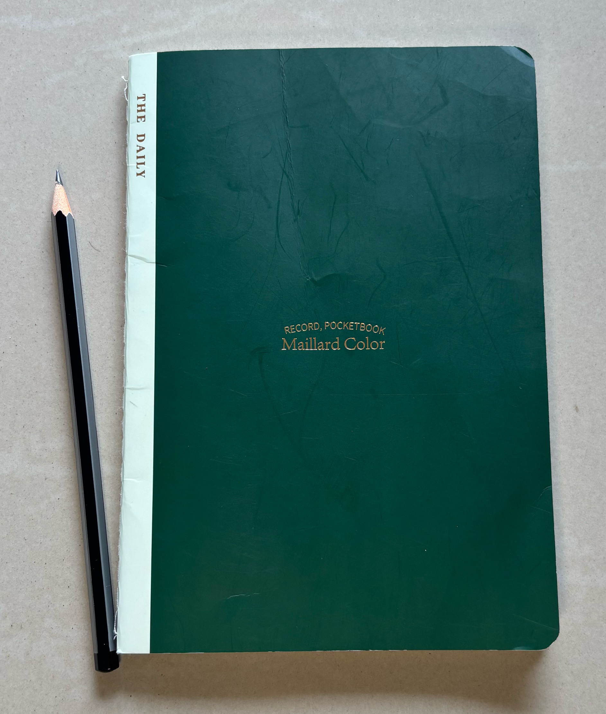
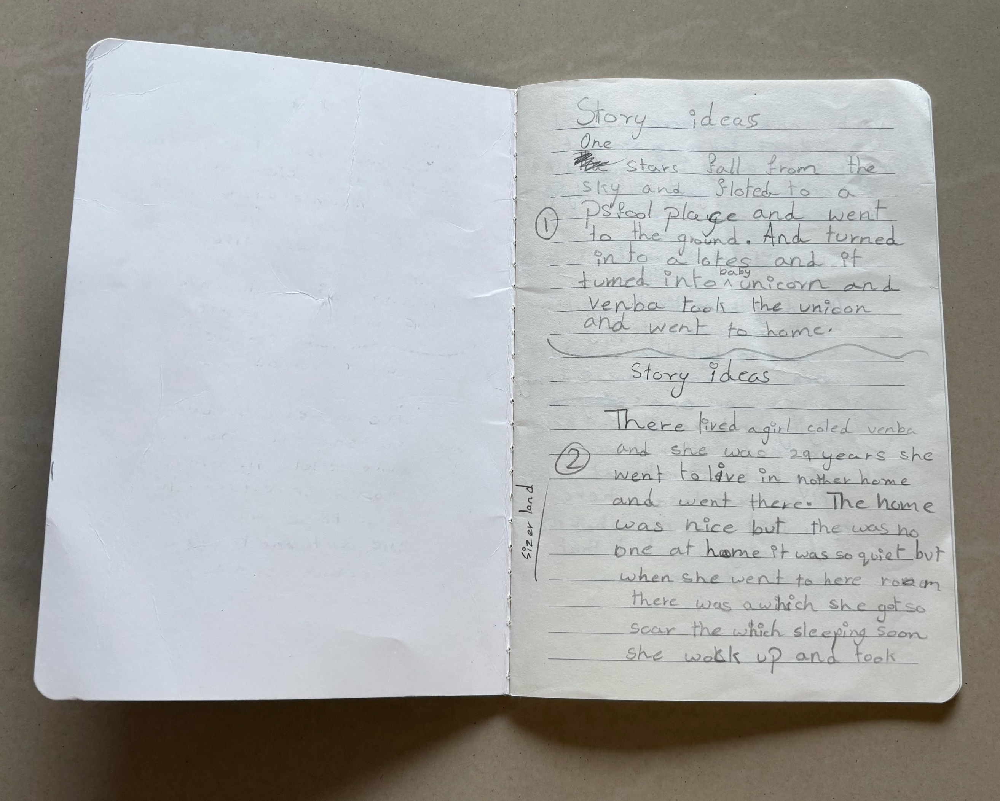
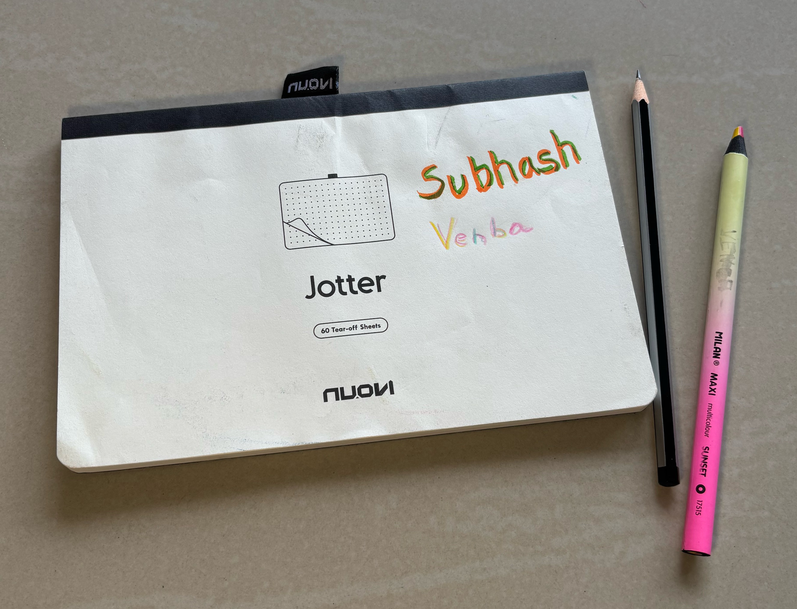
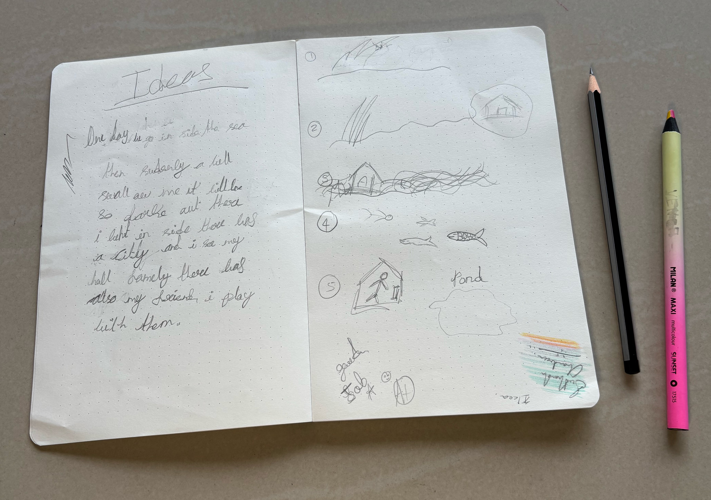
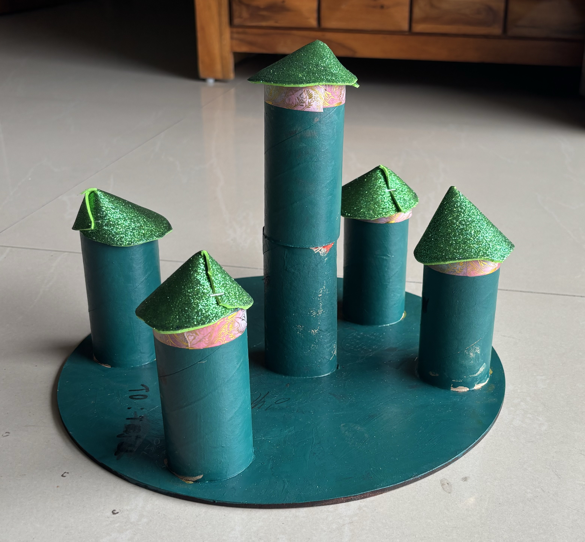
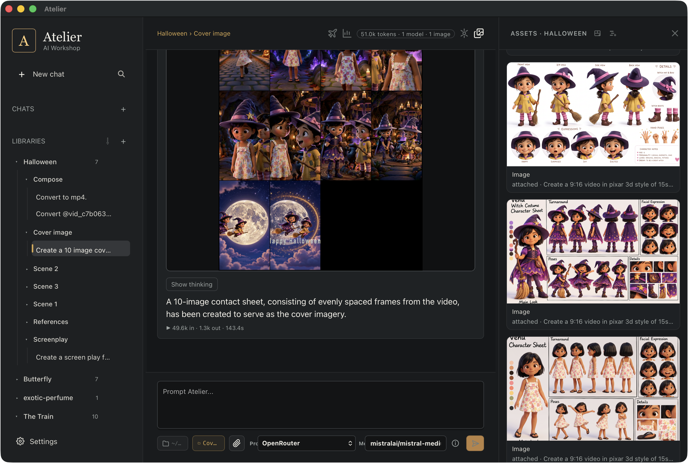

The movies on [The Fantastic Adventures of Venu](https://www.youtube.com/@TheFantasticAdventuresOfVenu) are a collaboration between my daughter, Venba, and me. I use Atelier to make the movies, but the process begins with the stories we tell each other in everyday life.

There are two books behind these movies: a green notebook where we record stories we like, and a drawing book where we work out their scenes. Together, they form a bridge between our conversations and the finished movie.

## 1. Ideation

Venba and I talk stories as part of our day-to-day life. We don't need to sit down with the intention of making a movie for a story to begin. The conversations themselves give us ideas to work with.

Talking a story through gives both of us room to contribute. An idea can change as we discuss it: what happens next, what a character might do, or how the story could end. We get to discover the story together before deciding whether to take it further.

This is where the Venu movies begin. The time we spend talking feeds the filmmaking process, giving us stories that we have already enjoyed sharing with each other.

## 2. The Story Notebook

We have a green notebook that Venba and I share. This is our Story Notebook: the place where we record stories we liked while discussing them.

A conversation can move quickly from one idea to another. Writing a story down gives us something to return to after the conversation has moved on. We can pick it up again, talk about it some more, and decide whether it is one we want to make into a movie.

The notebook also gives our shared storytelling a physical home. Before there is anything to watch on a screen, there is a story that we thought was worth keeping on paper.

  <figure style="margin: 0; min-width: 0;">
    
    <figcaption>Our green Story Notebook.</figcaption>
  </figure>
  <figure style="margin: 0; min-width: 0;">
    
    <figcaption>Stories we wanted to remember.</figcaption>
  </figure>

Select a photo to view it full size.

## 3. The Scene Drawboard

The next book is our Scene Drawboard, the drawing book I use with Venba to storyboard.

Here, we move from telling the story to thinking about what the audience will see. What belongs in a scene? What happens in the next one? How do the drawings carry the story forward?

Drawing gives us a shared way to discuss those questions. A scene on paper is something we can both look at and talk about. It helps us turn the story into a sequence of moments that can become a movie.

The two books serve different purposes. The green notebook holds the stories we want to remember. The Scene Drawboard helps us work out how to show one of those stories.

  <figure style="margin: 0; min-width: 0;">
    
    <figcaption>Our Scene Drawboard.</figcaption>
  </figure>
  <figure style="margin: 0; min-width: 0;">
    
    <figcaption>Working out the story, scene by scene.</figcaption>
  </figure>

Select a photo to view it full size.

## 4. Props

Venba's craft projects find their way into the movies too. Something she makes with her hands can become a prop in Venu's world, giving it a place in the stories we tell together.

One example is this castle, made from cardboard toilet roll tubes. The tubes became towers, with green roofs and colourful bands around the tops. We introduced her creation as the castle in our [Oz movie](https://www.youtube.com/watch?v=p6l61fLev3Y).



<figure>
  
  <figcaption>Venba's castle, made from cardboard toilet roll tubes, became the castle in the Oz movie.</figcaption>
</figure>

I like that her contribution can travel this way: from a craft project at home to something we can recognise on screen. Alongside the stories and drawings, these handmade objects give us another way to shape the movies together.

## 5. Movie Making with Atelier

With the story and storyboard as my starting point, I use [Atelier](https://www.wiztools.org/atelier/) to make the movie.

I turn the storyboard into images, animate them, and create the voices and music in Atelier. This takes the scenes we worked out on paper and gives them movement and sound.

<figure>
  
  <figcaption>Making a Venu movie in Atelier: movie frames and character references in the Halloween library.</figcaption>
</figure>

Once those pieces are ready, I move to Final Cut Pro (FCP) for the final edit. Atelier is where I create the material for the movie; FCP is where I bring it together into the finished film. For a tour of Atelier's tools, see [Getting Started with Atelier](https://www.wiztools.org/atelier/getting-started/).

The story and drawings give this stage its direction. There is already an idea to express and a sequence of scenes to work from. The creative decisions we made together on paper carry into the work I do in Atelier.

That journey—from a conversation with Venba, to the green notebook, to the Scene Drawboard, with handmade props along the way, and finally to a movie—is what I want to share alongside [Venu's adventures](https://www.youtube.com/@TheFantasticAdventuresOfVenu). Each finished movie has a father–daughter story behind its making.
